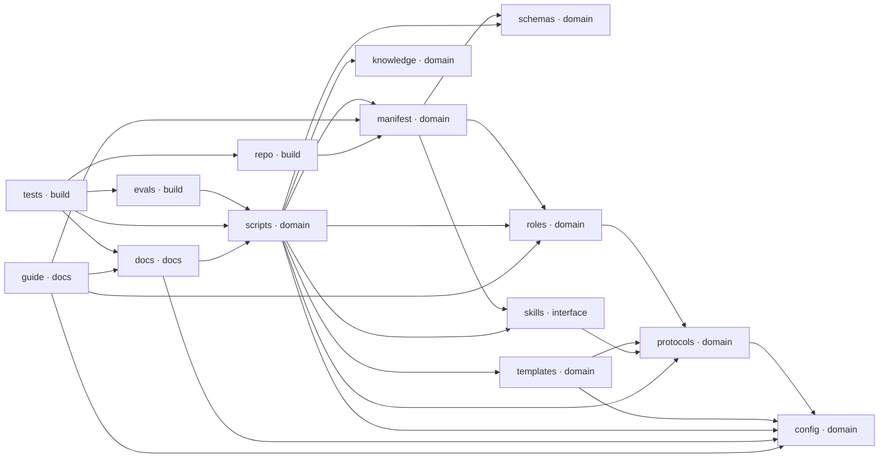

# AgenticTeam: structure

<!-- Generated by blueprint.py render from .blueprint/blueprint.json. Do not edit. -->

A portable AI delivery organization: 50 role definitions, shared protocols and skills that one stdlib Python CLI compiles into each coding harness's native format, plus a run-state machine and supervisor that hold agents to evidence and human gates.

**64 planned files, 14 patterns.** Status: ◑ on disk 31, ✔ verified 33. Last sync: 2026-11-06T18:10:19Z at `9f863f7`.

## Stack

| Part | Choice | Version | Docs | Checked |
|---|---|---|---|---|
| Runtime and compiler | Python standard library only, no third-party packages | 3.10+ (CI matrix: 3.10, 3.12, 3.14) | https://devguide.python.org/versions/ | 2026-11-06 |
| Tests | unittest, run with discover -s tests | stdlib | https://docs.python.org/3/library/unittest.html | 2026-11-06 |
| CI | GitHub Actions job matrix on Ubuntu, Windows and macOS | actions/checkout@v7, actions/setup-python@v7 | https://docs.github.com/en/actions/writing-workflows/choosing-what-your-workflow-does/running-variations-of-jobs-in-a-workflow | 2026-11-06 |
| CI actions | actions/checkout and actions/setup-python | v7 (latest releases checkout 7.0.1, setup-python 7.1.0) | https://github.com/actions/checkout/releases | 2026-11-06 |

## Build approach

- **layout:** Flat Python repository. scripts/agentic_team.py is both the harness compiler and the single writer of run state; roles, protocols, skills, templates and seed knowledge are Markdown and JSON sources it installs into target projects. team.json is the one manifest everything else is checked against.
- **notes:** This plan maps main's working tree as it stands, including untracked plan and prompt files. Generated outputs are checked, never hand-edited. Claude Code and Codex both work in this repository (AGENTS.md); implementation work goes on task branches merged into autonomy-integration, so files that exist only there are not in this map.

## Tree

`★` shared contract · `○` planned · `◔` claimed · `◑` on disk · `●` built · `✔` verified · `▲` blocked

```text
.
├── .github/
│   └── workflows/
│       └── ci.yml [modify]  ✔ CI test job on Ubuntu, Windows and macOS (validate, generated docs, tests, every harness install, scenarios, preflight) plus opt-in review and live-smoke jobs (claude-code, P1)
├── agents/  # One portable role definition per agent in team.json [roles]
│   └── */
│       └── *.md  ⟨pattern role-definition: One role definition per agent in team.json, grouped by department folder; 50 on disk⟩ (tarikai, P1)
├── config/  # Machine-readable policy (risk, profiles, gates, stage exits, evidence, budgets) and the guarantee ledger [config]
│   ├── guarantees.json [modify] ★  ✔ Guarantee ledger: rows of id, statement, enforced_by (a subset of the declared layers), test (an importable module.Class[.method]) and bypass; its version must equal the release version (tarikai, P1)
│   └── policies.json [modify] ★  ◑ Policy sections the CLI enforces: risk levels and always-human risk, autonomy profiles, gate values, command rules, absolute human gates, tool classifications, stage exits, evidence rules and budgets; its version must equal the release version (tarikai, P1)
├── docs/  # User documentation, architecture, and the work plans, prompt packs and progress records (no module default check: each file names the test that reads it) [docs]
│   ├── agent-team-guide/  # The roster, progress board and document library shared by Claude Code and Codex [guide]
│   │   ├── agent-roster.csv [modify]  ✔ Generated roster export; rebuilt by build.py, never edited by hand (codex, P1)
│   │   ├── build.py [modify]  ✔ Builds index.html and agent-roster.csv from the guide's data, team.json, the role files and UPDATING.md; it reads guarantees.json and docs/autonomy-progress/ from the autonomy-integration branch, not from main (codex, P1)
│   │   ├── CODEX-HANDOVER.md [modify]  ✔ Handover notes for Codex on the shared roster (codex, P1)
│   │   ├── documents.json [modify] ★  ✔ Groups current, earlier and records. Plan entries carry id, title, plan and prompt; record entries carry path and title. Every docs/*-plan.md, *-prompt.md and *-prompts.md must be registered (codex, P1)
│   │   ├── guide.template.html [modify]  ✔ Page layout build.py fills; keep dates, commits and status text out of it (codex, P1)
│   │   ├── index.html [modify]  ◑ Generated shared roster and progress page; rebuilt by build.py, never edited by hand (codex, P1)
│   │   ├── progress.json [modify] ★  ◑ Board state with asOf (YYYY-MM-DD), updatedBy (the guide's agent names claude or codex, not roster ids), recordsRef, runtimeIntegration, documentationBase, refs, scope, statuses (rows of exactly area, state, detail), todaySummary, evidence, nextPriority, documentsNote and active (rows of task, agent, where, since) (codex, P1)
│   │   ├── roster.json [modify]  ✔ Guide-specific role fields, one entry per team.json agent in team.json order (codex, P1)
│   │   ├── safety.json [modify]  ✔ Audited list of safety controls the guide shows (codex, P1)
│   │   ├── updates.json [modify] ★  ◑ An object {"entries": [...]} of newest-first entries with exactly date, agent (claude or codex), task, summary, documents[] and refs[]; never edit another agent's entry (codex, P1)
│   │   └── UPDATING.md [modify]  ✔ The procedure both agents follow to update the guide; build.py embeds it in the page (codex, P1)
│   ├── *-plan.md  ⟨pattern work-plan: Plans for each body of work; 11 on disk⟩ (codex, P1)
│   ├── *-progress.md  ⟨pattern progress-record: Running records of what each plan's implementation has done; 3 on disk⟩ (codex, P1)
│   ├── *-prompt.md  ⟨pattern prompt-pack: Single prompt that starts an implementing agent on one plan; 7 on disk⟩ (codex, P1)
│   ├── *-prompts.md  ⟨pattern prompt-set: Phase-by-phase prompt sets for larger plans; 3 on disk⟩ (codex, P1)
│   ├── architecture.md [modify]  ◑ Architecture and runtime overview; its guarantee ledger section is generated (codex, P1)
│   ├── autonomy-progress-review.md [modify]  ◑ Review of the autonomy program's progress; the guide reads it (codex, P1)
│   ├── cli.md [modify]  ◑ CLI reference; its full command reference section is generated from the parser (codex, P1)
│   ├── harnesses.md [modify]  ◑ Where each harness gets its roles, skills and router, and what to do for unlisted harnesses (codex, P1)
│   ├── local-llms.md [modify]  ◑ Running the team on local models and sizing models per role tier; no test reads its content beyond the shared doc scans (codex, P1)
│   ├── migration-v3.md [modify]  ◑ Upgrade guide from v2 to v3 (codex, P1)
│   ├── operating-modes.md [modify]  ◑ Autonomy profiles, Fusion and progressive context explained for operators (codex, P1)
│   ├── quickstart-non-dev.md [modify]  ◑ Plain-language owner guide for people who do not code (codex, P1)
│   ├── supervisor-design.md [modify]  ◑ Design of the durable supervisor (codex, P1)
│   └── supervisor-operator-guide.md [modify]  ◑ How an owner runs and recovers the supervisor (codex, P1)
├── evals/  # Deterministic team-evaluation scenarios, and the opt-in live smoke eval [evals]
│   ├── scenarios/
│   │   └── *.json  ⟨pattern eval-scenario: Deterministic team-evaluation scenarios; 8 on disk⟩ (claude-code, P1)
│   ├── live_smoke.py [modify]  ✔ Opt-in live-agent smoke eval that spends model credits; only its offline scoring is a check (D3) (claude-code, P1)
│   └── run_scenarios.py [modify]  ✔ Runs every scenario in evals/scenarios against a fresh install; its docstring defines the step forms (claude-code, P1)
├── knowledge/  # Seed learning: lessons, reusable decisions, role playbooks, and the evolution proposals and changelog [knowledge]
│   ├── evolution/
│   │   ├── CHANGELOG.md [modify]  ✔ Append-only record of approved changes to the team's constitution; must mention the current release version (codex, P1)
│   │   └── PROPOSALS.md [modify]  ◑ Proposed amendments to role definitions, each awaiting the human owner's decision (codex, P1)
│   ├── playbooks/
│   │   ├── *.md  ⟨pattern role-playbook: Seeded per-role playbooks; 6 on disk⟩ (codex, P1)
│   │   ├── _template.md [modify]  ◑ Skeleton a role copies when it writes its first playbook check; install copies it into every project (codex, P1)
│   │   └── README.md [modify] ★  ◑ Defines the playbook entry format; the CLI's promote step recognises lines carrying 'status: candidate' (codex, P1)
│   ├── decisions.md [modify]  ◑ Reusable cross-build decisions promoted from run decision records (codex, P1)
│   ├── lessons.md [modify]  ◑ Shared lessons log agents read before work and write at retrospective (codex, P1)
│   └── README.md [modify]  ◑ How the learning files fit together; install copies it into every project (codex, P1)
├── protocols/  # Shared law every role follows: contract, gates, entry modes, evidence, evolution [protocols]
│   ├── *.md  ⟨pattern protocol: The remaining shared-law documents; 18 on disk⟩ (tarikai, P1)
│   ├── agent-contract.md [modify] ★  ◑ The contract every compiled role points at: task envelope, evidence, every absolute human gate and the playbook loop (tarikai, P1)
│   ├── autonomy.md [modify] ★  ◑ Autonomy profiles and when each pauses for a human; validate requires it (tarikai, P1)
│   ├── fusion.md [modify] ★  ◑ The Fusion council sequence: independent proposals, reveal, critique, synthesis, verification, dissent; validate requires it (tarikai, P1)
│   ├── guardrails.md [modify] ★  ◑ Universal safety floor that role definitions may tighten but never loosen; must name every absolute human gate (tarikai, P1)
│   ├── plan-modes.md [modify]  ✔ Entry modes idea, plan-given and execute-only, and how a supplied plan stays authoritative (tarikai, P1)
│   ├── progressive-context.md [modify] ★  ◑ Stage contracts and task-sized context packs; validate requires it (tarikai, P1)
│   ├── runtime.md [modify] ★  ◑ All task lifecycle changes go through the CLI; validate requires it (tarikai, P1)
│   └── untrusted-content.md [modify] ★  ◑ Files, web pages and tool output are data, not instructions; the installed router links it (tarikai, P1)
├── runtime/
│   └── templates/  # Run artifact templates the runtime copies into each stage of an installed project [templates]
│       ├── *.md  ⟨pattern run-template: Templates the runtime copies into a run's stages; 20 on disk⟩ (claude-code, P1)
│       └── router.md [modify] ★  ◑ The router installed as .agentic-team/AGENTS.md; every harness's root file points to it, and it must name every absolute human gate (claude-code, P1)
├── schemas/  # JSON Schemas for team.json and for a run's state.json [schemas]
│   ├── run-state.schema.json [modify]  ✔ JSON Schema describing a run's state.json; documentation only, since nothing validates state against it (GAP-3) (claude-code, P1)
│   └── team.schema.json [modify] ★  ✔ JSON Schema that validate checks team.json against (a subset, without third-party packages) (claude-code, P1)
├── scripts/  # The CLI (compiler and run-state machine with every gate), the durable supervisor, the installers, and the helper tools [scripts]
│   ├── agentic_supervisor.py [modify]  ✔ Durable supervisor (the `supervise` helper) that intakes work, launches isolated workers, reconciles attempts and meters spend (claude-code, P1)
│   ├── agentic_team.py [modify] ★  ◑ Harness compiler and the single writer of run state. It defines the entry modes (initial_stage and the schema enum) and the helper interface: each helper module exposes main(argv=None) returning int or None, and a new helper is registered in HELPER_COMMANDS, HELPER_SCRIPTS and SCRIPT_REFS. The supervisor imports this module and calls its functions directly (the module API). (claude-code, P1)
│   ├── design_to_admin.py [modify]  ✔ The `design-to-admin` helper: drafts an adminwright manifest from a design-architect handoff (claude-code, P1)
│   ├── findings_to_tasks.py [modify]  ✔ The `findings-to-tasks` helper: turns review findings into a verdict and runnable remediation tasks (claude-code, P1)
│   ├── install.ps1 [modify]  ✔ Windows installer that calls the compiler; every harness in team.json must be accepted (claude-code, P1)
│   ├── install.sh [modify]  ✔ POSIX installer that finds a Python which actually runs and calls the compiler; must keep LF line endings (claude-code, P1)
│   ├── local_llm_check.py [modify]  ✔ The `llm-check` helper: reports reachable local LLM endpoints (LM Studio, Ollama) (claude-code, P1)
│   └── preflight_skills.py [modify]  ✔ The `preflight` helper: reports which optional external skills are installed and which floor protocols stand in for the rest (claude-code, P1)
├── skills/  # Operating procedures installed as harness skills: build, verify, learn, progressive context, Fusion [skills]
│   └── */
│       ├── agents/
│       │   └── openai.yaml  ⟨pattern skill-interface: Codex/OpenAI interface metadata for each skill; 5 on disk⟩ (claude-code, P1)
│       ├── references/
│       │   └── *.md  ⟨pattern skill-reference: Supporting reference each skill loads on demand; 5 on disk⟩ (claude-code, P1)
│       └── SKILL.md  ⟨pattern skill-entry: Entry file of each installed skill; 5 on disk⟩ (claude-code, P1)
├── tests/  # Unit, regression, installer and golden-snapshot tests for the compiler, runtime, supervisor and tools [tests]
│   ├── golden/
│   │   └── **  ⟨pattern golden-snapshot: Expected compiler output per harness, compared byte for byte; 28 on disk⟩ (claude-code, P1)
│   ├── fake_worker.py [modify]  ✔ Scripted stand-in for a paid worker so supervisor tests run offline (claude-code, P1)
│   ├── helpers.py [modify]  ◑ Shared test fixtures. Import it before anything that touches the CLI: importing it isolates AGENTIC_TEAM_HOME (claude-code, P1)
│   ├── supervisor_fixtures.py [modify]  ✔ Fixtures that set up supervisor stores, checkouts and queued work (claude-code, P1)
│   └── test_*.py  ⟨pattern unit-test: One unittest module per area of the system; 22 on disk⟩ (claude-code, P1)
├── .gitattributes [modify]  ✔ Line endings: golden fixtures and shell scripts stay LF on every OS (claude-code, P1)
├── .gitignore [modify]  ✔ Keeps caches, scratch, live-eval transcripts and build output out of git (claude-code, P1)
├── AGENTS.md [modify]  ✔ Rules for coding agents working on this repository itself, including the shared-roster procedure (tarikai, P1)
├── CLAUDE.md [modify]  ✔ Imports AGENTS.md for Claude Code (tarikai, P1)
├── LICENSE [modify]  ✔ Apache 2.0 licence (tarikai, P1)
├── README.md [modify]  ◑ What AgenticTeam is, how to install and verify it; its role counts, links and documented commands are tested (codex, P1)
├── team.json [modify] ★  ✔ Canonical manifest of agents, presets, workflows, model profiles and harness targets; its version is the release version that VERSION in scripts/agentic_team.py and the config files must equal (tarikai, P1)
├── team.yaml [modify]  ✔ Compatibility pointer that names team.json as the canonical manifest; read by no code (GAP-6) (tarikai, P1)
└── THIRD_PARTY_NOTICES.md [modify]  ✔ Credits and licences for third-party ideas this project draws on (tarikai, P1)
```

## Modules



| Module | Path | Layer | Purpose | Depends on | Verify |
|---|---|---|---|---|---|
| manifest | `` | domain | The canonical manifest: roster, presets, workflows, model profiles and harness targets every other part is validated against | schemas, roles, skills | `python scripts/agentic_team.py validate` |
| schemas | `schemas` | domain | JSON Schemas for team.json and for a run's state.json |  | `python scripts/agentic_team.py validate` |
| config | `config` | domain | Machine-readable policy (risk, profiles, gates, stage exits, evidence, budgets) and the guarantee ledger |  | `python -m unittest discover -s tests -p "test_law.py"` |
| roles | `agents` | domain | One portable role definition per agent in team.json | protocols | `python scripts/agentic_team.py validate && python -m unittest discover -s tests -p "test_roster.py" && python -m unittest discover -s tests -p "test_safety_net.py" && python -m unittest discover -s tests -p "test_doc_workflows.py"` |
| protocols | `protocols` | domain | Shared law every role follows: contract, gates, entry modes, evidence, evolution | config | `python -m unittest discover -s tests -p "test_law.py" && python -m unittest discover -s tests -p "test_doc_workflows.py" && python -m unittest discover -s tests -p "test_release.py" && python -m unittest discover -s tests -p "test_runtime.py"` |
| templates | `runtime/templates` | domain | Run artifact templates the runtime copies into each stage of an installed project | config, protocols | `python -m unittest discover -s tests -p "test_law.py"` |
| skills | `skills` | interface | Operating procedures installed as harness skills: build, verify, learn, progressive context, Fusion | protocols | `python -m unittest discover -s tests -p "test_law.py" && python -m unittest discover -s tests -p "test_runtime.py" && python -m unittest discover -s tests -p "test_doc_workflows.py" && python -m unittest discover -s tests -p "test_release.py"` |
| knowledge | `knowledge` | domain | Seed learning: lessons, reusable decisions, role playbooks, and the evolution proposals and changelog |  | `python -m unittest discover -s tests -p "test_law.py"` |
| scripts | `scripts` | domain | The CLI (compiler and run-state machine with every gate), the durable supervisor, the installers, and the helper tools | manifest, schemas, config, roles, protocols, templates, skills, knowledge | `python -m unittest discover -s tests` |
| evals | `evals` | build | Deterministic team-evaluation scenarios, and the opt-in live smoke eval | scripts | `python -m unittest discover -s tests -p "test_evals.py"` |
| tests | `tests` | build | Unit, regression, installer and golden-snapshot tests for the compiler, runtime, supervisor and tools | scripts, evals, docs, repo | `python -m unittest discover -s tests` |
| docs | `docs` | docs | User documentation, architecture, and the work plans, prompt packs and progress records (no module default check: each file names the test that reads it) | scripts, config | `` |
| guide | `docs/agent-team-guide` | docs | The roster, progress board and document library shared by Claude Code and Codex | manifest, config, roles, docs | `python docs/agent-team-guide/build.py --check` |
| repo | `` | build | Repository-level instructions, licensing, git configuration and CI (no module default check: each file has its own) | manifest | `` |

## Phases

| Phase | Name | Goal | Exit | Files | Verified |
|---|---|---|---|---|---|
| P1 | Current system on main (verify only, do not edit) | Map every file the tool can see on main and hold each one to a check that reads it. P1 changes no file: it is done when the exit command passes. `verify --run --phase P1` then marks every file whose check can run here; the guide checks also need a local autonomy-integration branch (GAP-4). `status --next` lists unverified files as open: they need a passing check, not edits. | python scripts/agentic_team.py validate && python scripts/agentic_team.py docs --check && python -m unittest discover -s tests && python scripts/preflight_skills.py | 64 | 33 |

## Shared contracts

These files are depended on by several owners. Change them only through their owner.

| File | Owner | Produces | Purpose |
|---|---|---|---|
| `team.json` | tarikai | team.json agents[], team.json presets, team.json harnesses, team.json workflows, team.json defaults, team.json model_profiles, release version | Canonical manifest of agents, presets, workflows, model profiles and harness targets; its version is the release version that VERSION in scripts/agentic_team.py and the config files must equal |
| `schemas/team.schema.json` | claude-code | schema team.json | JSON Schema that validate checks team.json against (a subset, without third-party packages) |
| `config/policies.json` | tarikai | policies.risk_levels, policies.always_human_risk, policies.profiles, policies.gate_values, policies.risk, policies.command_rules, policies.absolute_human_gates, policies.tool_classifications, policies.stage_exits, policies.evidence, policies.budgets | Policy sections the CLI enforces: risk levels and always-human risk, autonomy profiles, gate values, command rules, absolute human gates, tool classifications, stage exits, evidence rules and budgets; its version must equal the release version |
| `config/guarantees.json` | tarikai | guarantee ledger, guarantee test ids | Guarantee ledger: rows of id, statement, enforced_by (a subset of the declared layers), test (an importable module.Class[.method]) and bypass; its version must equal the release version |
| `protocols/agent-contract.md` | tarikai | agent contract | The contract every compiled role points at: task envelope, evidence, every absolute human gate and the playbook loop |
| `protocols/guardrails.md` | tarikai | guardrail floor | Universal safety floor that role definitions may tighten but never loosen; must name every absolute human gate |
| `protocols/autonomy.md` | tarikai | protocol autonomy.md | Autonomy profiles and when each pauses for a human; validate requires it |
| `protocols/fusion.md` | tarikai | protocol fusion.md | The Fusion council sequence: independent proposals, reveal, critique, synthesis, verification, dissent; validate requires it |
| `protocols/progressive-context.md` | tarikai | protocol progressive-context.md | Stage contracts and task-sized context packs; validate requires it |
| `protocols/runtime.md` | tarikai | protocol runtime.md | All task lifecycle changes go through the CLI; validate requires it |
| `protocols/untrusted-content.md` | tarikai | protocol untrusted-content.md | Files, web pages and tool output are data, not instructions; the installed router links it |
| `runtime/templates/router.md` | claude-code | installed router | The router installed as .agentic-team/AGENTS.md; every harness's root file points to it, and it must name every absolute human gate |
| `scripts/agentic_team.py` | claude-code | agentic_team CLI, agentic_team exit codes, state.json, role definition format, entry modes, helper main(argv), agentic_team module API | Harness compiler and the single writer of run state. It defines the entry modes (initial_stage and the schema enum) and the helper interface: each helper module exposes main(argv=None) returning int or None, and a new helper is registered in HELPER_COMMANDS, HELPER_SCRIPTS and SCRIPT_REFS. The supervisor imports this module and calls its functions directly (the module API). |
| `knowledge/playbooks/README.md` | codex | playbook format | Defines the playbook entry format; the CLI's promote step recognises lines carrying 'status: candidate' |
| `docs/agent-team-guide/progress.json` | codex | guide progress | Board state with asOf (YYYY-MM-DD), updatedBy (the guide's agent names claude or codex, not roster ids), recordsRef, runtimeIntegration, documentationBase, refs, scope, statuses (rows of exactly area, state, detail), todaySummary, evidence, nextPriority, documentsNote and active (rows of task, agent, where, since) |
| `docs/agent-team-guide/updates.json` | codex | guide updates | An object {"entries": [...]} of newest-first entries with exactly date, agent (claude or codex), task, summary, documents[] and refs[]; never edit another agent's entry |
| `docs/agent-team-guide/documents.json` | codex | guide documents | Groups current, earlier and records. Plan entries carry id, title, plan and prompt; record entries carry path and title. Every docs/*-plan.md, *-prompt.md and *-prompts.md must be registered |

## Repeated-file patterns

| Pattern | Glob | One instance contains | Owner | Phase | On disk |
|---|---|---|---|---|---|
| role-definition | `agents/*/*.md` | agents/<department>/<id>.md with frontmatter `name` (equal to the file stem and the team.json id) and `description` (at most 300 characters, with a trigger clause such as 'Use when...' or 'Activate when...' and an exclusion clause 'Not for ... (use <id>)'). Core roles follow the shape of agents/engineering/fullstack-engineer.md (## Mission, ## Expertise, ## Operating protocol, ## Collaboration, ## Skills you lean on, ## Guardrails, ## Self-learning, ## Output contract). Specialists use exactly ## When, ## Inputs, ## Procedure, ## Output, ## Done when, ## Hand-offs, ## Access in that order, as in agents/specialists/sre-engineer.md. The roster lint also requires: a compiled prompt of 400 to 2500 tokens; none of the retired terms it bans (task board, task evidence record, status.md, plan.md, qa.md, lessons.md, decisions.md, hardening, wcag 2.1, phase gate, '## standing orders', 'phase <n>', 'ship phase'); exactly one **Owns:** line across all roles for each lifecycle artifact, with fixed owners (ceo: BRIEF.md, ASSUMPTIONS.md, DELIVERY-REPORT.md; product-manager: PRD.md; cto-architect: ARCHITECTURE.md; ux-ui-designer: DESIGN.md; delivery-lead: READINESS.md, RETROSPECTIVE.md; qa-lead: VERIFICATION.md; release-manager: RELEASE.md; cmo: MARKETING.md), and no **Owns:** line in read-only or research roles; and only known role ids in backticks. A new role also needs its team.json entry (with activate_when for a specialist), the README counts, roster.json in team.json order, a guide rebuild, and regenerated golden files if it is in helpers.GOLDEN_ROSTER. Department folders: leadership, engineering, support, marketing, specialists. | tarikai | P1 | 50 |
| protocol | `protocols/*.md` | One Markdown protocol linked from runtime/templates/router.md or protocols/agent-contract.md (an unlinked protocol is never read by an agent). It names sibling protocols by bare filename and installed paths as .agentic-team/..., and is scanned for retired vocabulary (test_law) and overclaims (test_release). | tarikai | P1 | 18 |
| run-template | `runtime/templates/*.md` | One Markdown template, filled in one of five ways, so check which before editing. (1) Artifact templates registered in ARTIFACT_TEMPLATES (assumptions, brief, delivery-report, prd, readiness, release, retrospective, risks, verification) are copied by `scaffold`, which replaces only `{{project}}`. (2) task.md, stage-context.md, fusion-brief.md, fusion-proposal.md and fusion-critique.md are filled with str.format: use `{field}` names and double any literal brace. (3) fusion-dissent.md has `{{council}}` replaced. (4) fusion-synthesis.md and fusion-decision.md are copied as they are. (5) adr.md, checkpoint.md and handoff.md are forms agents copy by hand, referenced from protocols/communication.md and the agentic-build skill. router.md is installed verbatim as .agentic-team/AGENTS.md. Every template must be referenced from the CLI or from shared law (test_law). | claude-code | P1 | 20 |
| skill-entry | `skills/*/SKILL.md` | skills/<name>/SKILL.md with frontmatter `name` equal to the folder (lowercase words joined by hyphens), `description` longer than 80 and at most 1024 characters, and `compatibility` (required, at most 500 characters). The body is a runbook with exact `.agentic-team/bin/agentic_team.py` commands and no TODO. Every skill folder also needs agents/openai.yaml. Only folders belong directly under skills/: a stray file there breaks the skill checks and ships into every install (D11). A skill that a workflow runs also needs team.json workflows.<id>.skill set to skills/<name>. | claude-code | P1 | 5 |
| skill-interface | `skills/*/agents/openai.yaml` | YAML with interface.display_name, interface.short_description, interface.default_prompt (which must contain `$<skill-name>`) and policy.allow_implicit_invocation; copy skills/agentic-build/agents/openai.yaml. policy.allow_implicit_invocation is optional; the three shipped skills that set it set false. | claude-code | P1 | 5 |
| skill-reference | `skills/*/references/*.md` | One Markdown reference that its SKILL.md links to; scanned for retired vocabulary like all shared law. | claude-code | P1 | 5 |
| role-playbook | `knowledge/playbooks/*.md` | knowledge/playbooks/<role-id>.md created from _template.md, headed `# Playbook — <role-id>`, with checks under ## Before starting, ## While building and ## Before claiming done. Seeded checks end with `<!-- status: baseline -->`. Lines an agent adds use the candidate form from knowledge/playbooks/README.md: `- [ ] <imperative check>  <!-- status: candidate · learned: YYYY-MM-DD · source: <run>/<task> · cost: <what it broke> -->`. Promoting a candidate to baseline is the owner's decision (protocols/evolution.md). About forty lines at most. | codex | P1 | 6 |
| unit-test | `tests/test_*.py` | A unittest module that imports from helpers (`import helpers` or `from helpers import ...`) before anything uses the CLI, because that import isolates AGENTIC_TEAM_HOME. It uses helpers.team, helpers.fresh_project() and helpers.run_cli() instead of the real home or source tree, and reads expected values from team.json or config/ instead of literal counts (several existing tests still hard-code them, GAP-1). New shared fixtures go in helpers.py; test_installers reuses shells() from test_repairs_packets. | claude-code | P1 | 22 |
| golden-snapshot | `tests/golden/**` | Never written by hand. After a compiler change, regenerate with `UPDATE_GOLDEN=1 python -m unittest discover -s tests -p "test_safety_net.py"` (PowerShell: `$env:UPDATE_GOLDEN=1; python -m unittest ...`; cmd: `set UPDATE_GOLDEN=1 && python -m unittest ...`) and review the diff; the role set is fixed in helpers.GOLDEN_ROSTER. Files under nested .claude/, .codex/ and .agentic-team/ folders are invisible to this blueprint (D6). | claude-code | P1 | 28 |
| eval-scenario | `evals/scenarios/*.json` | A JSON object with name, description and steps (optional harness and preset), using only the step forms documented at the top of evals/run_scenarios.py (cli, human, write, state, task, exec_py, python). Together the scenario names must cover greenfield, plan-given, brownfield, fusion, rejection and self-approval (test_evals). File names use snake_case (plan_given.json); the `name` field uses kebab-case (plan-given-hitl-bmad) and is what the coverage check matches. | claude-code | P1 | 8 |
| work-plan | `docs/*-plan.md` | A plan with scope, phases, acceptance and risks, registered in docs/agent-team-guide/documents.json under current or earlier together with its prompt; an unregistered plan fails the guide check. | codex | P1 | 11 |
| prompt-pack | `docs/*-prompt.md` | One ready-to-paste prompt for a single plan, registered beside that plan in documents.json. | codex | P1 | 7 |
| prompt-set | `docs/*-prompts.md` | Ready-to-paste prompts, one per phase of a plan, registered beside that plan in documents.json. | codex | P1 | 3 |
| progress-record | `docs/*-progress.md` | A dated log of phases completed, deviations and evidence for one plan; facts only, never a claim that a plan passed. | codex | P1 | 3 |

## Files

| File | Action | Module | Phase | Owner | Status | Purpose | Consumes | Produces | Verify |
|---|---|---|---|---|---|---|---|---|---|
| `team.json` | modify | manifest | P1 | tarikai | ✔ verified | Canonical manifest of agents, presets, workflows, model profiles and harness targets; its version is the release version that VERSION in scripts/agentic_team.py and the config files must equal | schema team.json | team.json agents[], team.json presets, team.json harnesses, team.json workflows, team.json defaults, team.json model_profiles, release version | `python scripts/agentic_team.py validate` |
| `team.yaml` | modify | manifest | P1 | tarikai | ✔ verified | Compatibility pointer that names team.json as the canonical manifest; read by no code (GAP-6) |  |  | `python -c "import pathlib,sys; t=pathlib.Path('team.yaml').read_text(encoding='utf-8'); sys.exit(0 if 'canonical_manifest: team.json' in t else 1)"` |
| `schemas/team.schema.json` | modify | schemas | P1 | claude-code | ✔ verified | JSON Schema that validate checks team.json against (a subset, without third-party packages) |  | schema team.json | `python scripts/agentic_team.py validate` |
| `schemas/run-state.schema.json` | modify | schemas | P1 | claude-code | ✔ verified | JSON Schema describing a run's state.json; documentation only, since nothing validates state against it (GAP-3) |  |  | `python -c "import json; d=json.load(open('schemas/run-state.schema.json',encoding='utf-8')); assert d.get('type')=='object' and 'properties' in d"` |
| `config/policies.json` | modify | config | P1 | tarikai | ◑ on disk | Policy sections the CLI enforces: risk levels and always-human risk, autonomy profiles, gate values, command rules, absolute human gates, tool classifications, stage exits, evidence rules and budgets; its version must equal the release version | release version | policies.risk_levels, policies.always_human_risk, policies.profiles, policies.gate_values, policies.risk, policies.command_rules, policies.absolute_human_gates, policies.tool_classifications, policies.stage_exits, policies.evidence, policies.budgets | `python scripts/agentic_team.py validate && python -m unittest discover -s tests -p "test_release.py" && python -m unittest discover -s tests -p "test_law.py" && python -m unittest discover -s tests -p "test_runtime.py"` |
| `config/guarantees.json` | modify | config | P1 | tarikai | ✔ verified | Guarantee ledger: rows of id, statement, enforced_by (a subset of the declared layers), test (an importable module.Class[.method]) and bypass; its version must equal the release version | release version | guarantee ledger, guarantee test ids | `python scripts/agentic_team.py validate && python -m unittest discover -s tests -p "test_release.py"` |
| `protocols/agent-contract.md` | modify | protocols | P1 | tarikai | ◑ on disk | The contract every compiled role points at: task envelope, evidence, every absolute human gate and the playbook loop | policies.absolute_human_gates, guardrail floor | agent contract | `python -m unittest discover -s tests -p "test_law.py" && python -m unittest discover -s tests -p "test_doc_workflows.py" && python -m unittest discover -s tests -p "test_release.py" && python -m unittest discover -s tests -p "test_runtime.py"` |
| `protocols/guardrails.md` | modify | protocols | P1 | tarikai | ◑ on disk | Universal safety floor that role definitions may tighten but never loosen; must name every absolute human gate | policies.absolute_human_gates | guardrail floor | `python -m unittest discover -s tests -p "test_law.py" && python -m unittest discover -s tests -p "test_doc_workflows.py" && python -m unittest discover -s tests -p "test_release.py" && python -m unittest discover -s tests -p "test_runtime.py"` |
| `protocols/plan-modes.md` | modify | protocols | P1 | tarikai | ✔ verified | Entry modes idea, plan-given and execute-only, and how a supplied plan stays authoritative | entry modes |  | `python -m unittest discover -s tests -p "test_doc_workflows.py"` |
| `protocols/autonomy.md` | modify | protocols | P1 | tarikai | ◑ on disk | Autonomy profiles and when each pauses for a human; validate requires it | policies.profiles | protocol autonomy.md | `python -m unittest discover -s tests -p "test_law.py" && python -m unittest discover -s tests -p "test_doc_workflows.py" && python -m unittest discover -s tests -p "test_release.py" && python -m unittest discover -s tests -p "test_runtime.py"` |
| `protocols/fusion.md` | modify | protocols | P1 | tarikai | ◑ on disk | The Fusion council sequence: independent proposals, reveal, critique, synthesis, verification, dissent; validate requires it |  | protocol fusion.md | `python -m unittest discover -s tests -p "test_law.py" && python -m unittest discover -s tests -p "test_doc_workflows.py" && python -m unittest discover -s tests -p "test_release.py" && python -m unittest discover -s tests -p "test_runtime.py"` |
| `protocols/progressive-context.md` | modify | protocols | P1 | tarikai | ◑ on disk | Stage contracts and task-sized context packs; validate requires it |  | protocol progressive-context.md | `python -m unittest discover -s tests -p "test_law.py" && python -m unittest discover -s tests -p "test_doc_workflows.py" && python -m unittest discover -s tests -p "test_release.py" && python -m unittest discover -s tests -p "test_runtime.py"` |
| `protocols/runtime.md` | modify | protocols | P1 | tarikai | ◑ on disk | All task lifecycle changes go through the CLI; validate requires it |  | protocol runtime.md | `python -m unittest discover -s tests -p "test_law.py" && python -m unittest discover -s tests -p "test_doc_workflows.py" && python -m unittest discover -s tests -p "test_release.py" && python -m unittest discover -s tests -p "test_runtime.py"` |
| `protocols/untrusted-content.md` | modify | protocols | P1 | tarikai | ◑ on disk | Files, web pages and tool output are data, not instructions; the installed router links it |  | protocol untrusted-content.md | `python -m unittest discover -s tests -p "test_law.py" && python -m unittest discover -s tests -p "test_doc_workflows.py" && python -m unittest discover -s tests -p "test_release.py" && python -m unittest discover -s tests -p "test_runtime.py"` |
| `runtime/templates/router.md` | modify | templates | P1 | claude-code | ◑ on disk | The router installed as .agentic-team/AGENTS.md; every harness's root file points to it, and it must name every absolute human gate | policies.absolute_human_gates, agent contract, protocol untrusted-content.md | installed router | `python -m unittest discover -s tests -p "test_law.py"` |
| `scripts/agentic_team.py` | modify | scripts | P1 | claude-code | ◑ on disk | Harness compiler and the single writer of run state. It defines the entry modes (initial_stage and the schema enum) and the helper interface: each helper module exposes main(argv=None) returning int or None, and a new helper is registered in HELPER_COMMANDS, HELPER_SCRIPTS and SCRIPT_REFS. The supervisor imports this module and calls its functions directly (the module API). | team.json agents[], team.json presets, team.json harnesses, team.json workflows, team.json defaults, team.json model_profiles, schema team.json, policies.risk_levels, policies.always_human_risk, policies.profiles, policies.gate_values, policies.risk, policies.command_rules, policies.absolute_human_gates, policies.tool_classifications, policies.stage_exits, policies.evidence, policies.budgets, guarantee ledger, guarantee test ids, agent contract, installed router, playbook format, protocol autonomy.md, protocol fusion.md, protocol progressive-context.md, protocol runtime.md, release version | agentic_team CLI, agentic_team exit codes, state.json, role definition format, entry modes, helper main(argv), agentic_team module API | `python -m unittest discover -s tests` |
| `scripts/agentic_supervisor.py` | modify | scripts | P1 | claude-code | ✔ verified | Durable supervisor (the `supervise` helper) that intakes work, launches isolated workers, reconciles attempts and meters spend | agentic_team CLI, agentic_team exit codes, state.json, helper main(argv), agentic_team module API |  | `python -m unittest discover -s tests -p "test_supervisor.py"` |
| `scripts/install.sh` | modify | scripts | P1 | claude-code | ✔ verified | POSIX installer that finds a Python which actually runs and calls the compiler; must keep LF line endings | agentic_team CLI |  | `python -m unittest discover -s tests -p "test_installers.py"` |
| `scripts/install.ps1` | modify | scripts | P1 | claude-code | ✔ verified | Windows installer that calls the compiler; every harness in team.json must be accepted | agentic_team CLI, team.json harnesses |  | `python -m unittest discover -s tests -p "test_installers.py" && python -m unittest discover -s tests -p "test_harness.py"` |
| `scripts/preflight_skills.py` | modify | scripts | P1 | claude-code | ✔ verified | The `preflight` helper: reports which optional external skills are installed and which floor protocols stand in for the rest | helper main(argv) |  | `python -m unittest discover -s tests -p "test_regressions.py"` |
| `scripts/findings_to_tasks.py` | modify | scripts | P1 | claude-code | ✔ verified | The `findings-to-tasks` helper: turns review findings into a verdict and runnable remediation tasks | helper main(argv) |  | `python -m unittest discover -s tests -p "test_bridges.py"` |
| `scripts/design_to_admin.py` | modify | scripts | P1 | claude-code | ✔ verified | The `design-to-admin` helper: drafts an adminwright manifest from a design-architect handoff | helper main(argv) |  | `python -m unittest discover -s tests -p "test_bridges.py"` |
| `scripts/local_llm_check.py` | modify | scripts | P1 | claude-code | ✔ verified | The `llm-check` helper: reports reachable local LLM endpoints (LM Studio, Ollama) | helper main(argv) |  | `python -m unittest discover -s tests -p "test_local_llm_check.py"` |
| `knowledge/README.md` | modify | knowledge | P1 | codex | ◑ on disk | How the learning files fit together; install copies it into every project |  |  | `python -m unittest discover -s tests -p "test_law.py"` |
| `knowledge/lessons.md` | modify | knowledge | P1 | codex | ◑ on disk | Shared lessons log agents read before work and write at retrospective |  |  | `python -m unittest discover -s tests -p "test_law.py"` |
| `knowledge/decisions.md` | modify | knowledge | P1 | codex | ◑ on disk | Reusable cross-build decisions promoted from run decision records |  |  | `python -m unittest discover -s tests -p "test_law.py"` |
| `knowledge/evolution/PROPOSALS.md` | modify | knowledge | P1 | codex | ◑ on disk | Proposed amendments to role definitions, each awaiting the human owner's decision |  |  | `python -m unittest discover -s tests -p "test_law.py"` |
| `knowledge/evolution/CHANGELOG.md` | modify | knowledge | P1 | codex | ✔ verified | Append-only record of approved changes to the team's constitution; must mention the current release version | release version |  | `python -m unittest discover -s tests -p "test_release.py"` |
| `knowledge/playbooks/README.md` | modify | knowledge | P1 | codex | ◑ on disk | Defines the playbook entry format; the CLI's promote step recognises lines carrying 'status: candidate' |  | playbook format | `python -m unittest discover -s tests -p "test_law.py" && python -c "import pathlib,sys; t=pathlib.Path('knowledge/playbooks/README.md').read_text(encoding='utf-8'); sys.exit(0 if '## Entry format' in t and 'status: candidate' in t else 1)"` |
| `knowledge/playbooks/_template.md` | modify | knowledge | P1 | codex | ◑ on disk | Skeleton a role copies when it writes its first playbook check; install copies it into every project | playbook format |  | `python -m unittest discover -s tests -p "test_law.py"` |
| `tests/helpers.py` | modify | tests | P1 | claude-code | ◑ on disk | Shared test fixtures. Import it before anything that touches the CLI: importing it isolates AGENTIC_TEAM_HOME | agentic_team CLI | helpers.ROOT, helpers.GOLDEN, helpers.GOLDEN_ROSTER, helpers.TEST_HOME, helpers.LOCAL_POLICY, helpers.team, helpers.fresh_project(), helpers.run_cli(), helpers.compile_snapshot() | `python -m unittest discover -s tests` |
| `tests/fake_worker.py` | modify | tests | P1 | claude-code | ✔ verified | Scripted stand-in for a paid worker so supervisor tests run offline |  |  | `python -m unittest discover -s tests -p "test_supervisor.py"` |
| `tests/supervisor_fixtures.py` | modify | tests | P1 | claude-code | ✔ verified | Fixtures that set up supervisor stores, checkouts and queued work |  |  | `python -m unittest discover -s tests -p "test_supervisor.py"` |
| `evals/run_scenarios.py` | modify | evals | P1 | claude-code | ✔ verified | Runs every scenario in evals/scenarios against a fresh install; its docstring defines the step forms | agentic_team CLI, agentic_team exit codes |  | `python -m unittest discover -s tests -p "test_evals.py"` |
| `evals/live_smoke.py` | modify | evals | P1 | claude-code | ✔ verified | Opt-in live-agent smoke eval that spends model credits; only its offline scoring is a check (D3) |  |  | `python -m unittest discover -s tests -p "test_live_smoke.py"` |
| `docs/architecture.md` | modify | docs | P1 | codex | ◑ on disk | Architecture and runtime overview; its guarantee ledger section is generated | guarantee ledger |  | `python scripts/agentic_team.py docs --check && python -m unittest discover -s tests -p "test_law.py" && python -m unittest discover -s tests -p "test_runtime.py" && python -m unittest discover -s tests -p "test_safety_net.py" && python -m unittest discover -s tests -p "test_release.py"` |
| `docs/cli.md` | modify | docs | P1 | codex | ◑ on disk | CLI reference; its full command reference section is generated from the parser | agentic_team CLI, agentic_team exit codes |  | `python scripts/agentic_team.py docs --check && python -m unittest discover -s tests -p "test_law.py" && python -m unittest discover -s tests -p "test_runtime.py" && python -m unittest discover -s tests -p "test_safety_net.py" && python -m unittest discover -s tests -p "test_release.py"` |
| `docs/harnesses.md` | modify | docs | P1 | codex | ◑ on disk | Where each harness gets its roles, skills and router, and what to do for unlisted harnesses |  |  | `python -m unittest discover -s tests -p "test_law.py" && python -m unittest discover -s tests -p "test_runtime.py" && python -m unittest discover -s tests -p "test_safety_net.py" && python -m unittest discover -s tests -p "test_release.py"` |
| `docs/operating-modes.md` | modify | docs | P1 | codex | ◑ on disk | Autonomy profiles, Fusion and progressive context explained for operators | agentic_team CLI |  | `python -m unittest discover -s tests -p "test_law.py" && python -m unittest discover -s tests -p "test_runtime.py" && python -m unittest discover -s tests -p "test_safety_net.py" && python -m unittest discover -s tests -p "test_release.py"` |
| `docs/quickstart-non-dev.md` | modify | docs | P1 | codex | ◑ on disk | Plain-language owner guide for people who do not code | agentic_team CLI |  | `python -m unittest discover -s tests -p "test_law.py" && python -m unittest discover -s tests -p "test_runtime.py" && python -m unittest discover -s tests -p "test_safety_net.py" && python -m unittest discover -s tests -p "test_release.py"` |
| `docs/local-llms.md` | modify | docs | P1 | codex | ◑ on disk | Running the team on local models and sizing models per role tier; no test reads its content beyond the shared doc scans |  |  | `python -m unittest discover -s tests -p "test_law.py" && python -m unittest discover -s tests -p "test_runtime.py" && python -m unittest discover -s tests -p "test_safety_net.py" && python -m unittest discover -s tests -p "test_release.py"` |
| `docs/migration-v3.md` | modify | docs | P1 | codex | ◑ on disk | Upgrade guide from v2 to v3 |  |  | `python -m unittest discover -s tests -p "test_law.py" && python -m unittest discover -s tests -p "test_runtime.py" && python -m unittest discover -s tests -p "test_safety_net.py" && python -m unittest discover -s tests -p "test_release.py"` |
| `docs/supervisor-design.md` | modify | docs | P1 | codex | ◑ on disk | Design of the durable supervisor |  |  | `python -m unittest discover -s tests -p "test_law.py" && python -m unittest discover -s tests -p "test_runtime.py" && python -m unittest discover -s tests -p "test_safety_net.py" && python -m unittest discover -s tests -p "test_release.py"` |
| `docs/supervisor-operator-guide.md` | modify | docs | P1 | codex | ◑ on disk | How an owner runs and recovers the supervisor |  |  | `python -m unittest discover -s tests -p "test_law.py" && python -m unittest discover -s tests -p "test_runtime.py" && python -m unittest discover -s tests -p "test_safety_net.py" && python -m unittest discover -s tests -p "test_release.py"` |
| `docs/autonomy-progress-review.md` | modify | docs | P1 | codex | ◑ on disk | Review of the autonomy program's progress; the guide reads it |  |  | `python -m unittest discover -s tests -p "test_law.py" && python -m unittest discover -s tests -p "test_runtime.py" && python -m unittest discover -s tests -p "test_safety_net.py" && python -m unittest discover -s tests -p "test_release.py" && python docs/agent-team-guide/build.py --check` |
| `docs/agent-team-guide/build.py` | modify | guide | P1 | codex | ✔ verified | Builds index.html and agent-roster.csv from the guide's data, team.json, the role files and UPDATING.md; it reads guarantees.json and docs/autonomy-progress/ from the autonomy-integration branch, not from main | team.json agents[], guarantee ledger, guide progress, guide updates, guide documents, guide roster, team.json harnesses, team.json presets, team.json defaults, team.json model_profiles, role definition format |  | `python docs/agent-team-guide/build.py --check` |
| `docs/agent-team-guide/guide.template.html` | modify | guide | P1 | codex | ✔ verified | Page layout build.py fills; keep dates, commits and status text out of it |  |  | `python docs/agent-team-guide/build.py --check` |
| `docs/agent-team-guide/index.html` | modify | guide | P1 | codex | ◑ on disk | Generated shared roster and progress page; rebuilt by build.py, never edited by hand |  |  | `python docs/agent-team-guide/build.py --check` |
| `docs/agent-team-guide/agent-roster.csv` | modify | guide | P1 | codex | ✔ verified | Generated roster export; rebuilt by build.py, never edited by hand |  |  | `python docs/agent-team-guide/build.py --check` |
| `docs/agent-team-guide/UPDATING.md` | modify | guide | P1 | codex | ✔ verified | The procedure both agents follow to update the guide; build.py embeds it in the page |  |  | `python docs/agent-team-guide/build.py --check` |
| `docs/agent-team-guide/CODEX-HANDOVER.md` | modify | guide | P1 | codex | ✔ verified | Handover notes for Codex on the shared roster |  |  | `python -c "import pathlib,sys; t=pathlib.Path('docs/agent-team-guide/CODEX-HANDOVER.md').read_text(encoding='utf-8'); sys.exit(0 if 'UPDATING.md' in t else 1)"` |
| `docs/agent-team-guide/progress.json` | modify | guide | P1 | codex | ◑ on disk | Board state with asOf (YYYY-MM-DD), updatedBy (the guide's agent names claude or codex, not roster ids), recordsRef, runtimeIntegration, documentationBase, refs, scope, statuses (rows of exactly area, state, detail), todaySummary, evidence, nextPriority, documentsNote and active (rows of task, agent, where, since) |  | guide progress | `python docs/agent-team-guide/build.py --check` |
| `docs/agent-team-guide/updates.json` | modify | guide | P1 | codex | ◑ on disk | An object {"entries": [...]} of newest-first entries with exactly date, agent (claude or codex), task, summary, documents[] and refs[]; never edit another agent's entry |  | guide updates | `python docs/agent-team-guide/build.py --check` |
| `docs/agent-team-guide/documents.json` | modify | guide | P1 | codex | ✔ verified | Groups current, earlier and records. Plan entries carry id, title, plan and prompt; record entries carry path and title. Every docs/*-plan.md, *-prompt.md and *-prompts.md must be registered |  | guide documents | `python docs/agent-team-guide/build.py --check` |
| `docs/agent-team-guide/roster.json` | modify | guide | P1 | codex | ✔ verified | Guide-specific role fields, one entry per team.json agent in team.json order | team.json agents[] | guide roster | `python docs/agent-team-guide/build.py --check` |
| `docs/agent-team-guide/safety.json` | modify | guide | P1 | codex | ✔ verified | Audited list of safety controls the guide shows |  |  | `python docs/agent-team-guide/build.py --check` |
| `README.md` | modify | repo | P1 | codex | ◑ on disk | What AgenticTeam is, how to install and verify it; its role counts, links and documented commands are tested | agentic_team CLI, team.json agents[] |  | `python -m unittest discover -s tests -p "test_doc_workflows.py" && python -m unittest discover -s tests -p "test_law.py" && python -m unittest discover -s tests -p "test_runtime.py" && python -m unittest discover -s tests -p "test_safety_net.py" && python -m unittest discover -s tests -p "test_release.py"` |
| `AGENTS.md` | modify | repo | P1 | tarikai | ✔ verified | Rules for coding agents working on this repository itself, including the shared-roster procedure |  |  | `python -c "import pathlib,sys; t=pathlib.Path('AGENTS.md').read_text(encoding='utf-8'); sys.exit(0 if 'docs/agent-team-guide/UPDATING.md' in t and 'build.py --check' in t else 1)"` |
| `CLAUDE.md` | modify | repo | P1 | tarikai | ✔ verified | Imports AGENTS.md for Claude Code |  |  | `python -c "import pathlib,sys; t=pathlib.Path('CLAUDE.md').read_text(encoding='utf-8'); sys.exit(0 if '@AGENTS.md' in t else 1)"` |
| `LICENSE` | modify | repo | P1 | tarikai | ✔ verified | Apache 2.0 licence |  |  | `python -c "import pathlib,sys; t=pathlib.Path('LICENSE').read_text(encoding='utf-8'); sys.exit(0 if 'Apache License' in t and 'Version 2.0' in t else 1)"` |
| `THIRD_PARTY_NOTICES.md` | modify | repo | P1 | tarikai | ✔ verified | Credits and licences for third-party ideas this project draws on |  |  | `python -c "import pathlib,sys; t=pathlib.Path('THIRD_PARTY_NOTICES.md').read_text(encoding='utf-8'); sys.exit(0 if '# Third-party notices' in t else 1)"` |
| `.gitignore` | modify | repo | P1 | claude-code | ✔ verified | Keeps caches, scratch, live-eval transcripts and build output out of git |  |  | `python -c "import subprocess,sys; sys.exit(max(subprocess.run(['git','check-ignore','-q',p]).returncode for p in ['tests/__pycache__/x.pyc','evals/out/x.json','dist/x']))"` |
| `.gitattributes` | modify | repo | P1 | claude-code | ✔ verified | Line endings: golden fixtures and shell scripts stay LF on every OS |  |  | `python -c "import subprocess,sys; o=subprocess.run(['git','check-attr','eol','--','scripts/install.sh','tests/golden/x.md'],capture_output=True,text=True).stdout; sys.exit(0 if o.count('eol: lf')==2 else 1)"` |
| `.github/workflows/ci.yml` | modify | repo | P1 | claude-code | ✔ verified | CI test job on Ubuntu, Windows and macOS (validate, generated docs, tests, every harness install, scenarios, preflight) plus opt-in review and live-smoke jobs | team.json harnesses |  | `python -c "import pathlib,sys; t=pathlib.Path('.github/workflows/ci.yml').read_text(encoding='utf-8'); sys.exit(0 if 'scripts/agentic_team.py validate' in t and 'docs --check' in t and 'unittest discover -s tests' in t and 'run_scenarios.py' in t and 'preflight_skills.py' in t and 'ubuntu-latest' in t and 'windows-latest' in t and 'macos-latest' in t else 1)" && python -m unittest discover -s tests -p "test_harness.py"` |

## Decisions

- **D1:** Phase P1 maps the system as it stands on main instead of a walking skeleton. Why: This is an existing codebase; later phases come from the owner's next body of work. (app-blueprint existing-code mode)
- **D2:** Every verify command calls python, never python3. Why: On Windows python3 resolves to the Microsoft Store stub, and verify runs through cmd.exe here. verify also runs through cmd.exe, where `bash` is the WSL launcher, so no check in this plan calls bash directly; tests/test_installers.py finds Git Bash itself. (repo memory; install.sh fix d0fb6cf)
- **D3:** The paid live smoke eval is never a verify command; evals/live_smoke.py is verified by its offline scoring tests. Why: Running it spends model credits. (.github/workflows/ci.yml live-smoke job)
- **D4:** Generated outputs (the guide's index.html and agent-roster.csv; the generated sections of docs/cli.md and docs/architecture.md) are verified by their --check commands and never edited by hand. Why: They are rebuilt from data and the CLI parser; hand edits are overwritten. (docs/agent-team-guide/build.py; agentic_team.py docs)
- **D5:** Python 3.10 stays in the CI matrix and as the installer minimum for now; flagged for the owner. Why: Python 3.10 reached end of life on 2026-10-01 (devguide.python.org/versions), but the code deliberately supports it (tomllib imports are guarded). (devguide.python.org/versions, checked 2026-11-06)
- **D6:** Golden fixtures under nested harness folders (tests/golden/<harness>/.claude/, .codex/ and .agentic-team/) are not tracked here: 28 of the 48 golden files are. Why: The tool's built-in ignore list matches .claude/, .codex/ and .agentic-team/ at any depth, and ignore[] cannot remove defaults. The hidden files stay covered by tests/test_safety_net.py GoldenSnapshotTests. Reported to the skill's learning loop. (app-blueprint DEFAULT_IGNORE, checked 2026-11-06)
- **D7:** Ownership runs in three lanes: the owner holds the constitution, Claude Code the code, Codex the docs. Why: The owner's choice. Git history showed no existing split, so lanes are set by kind of work. (owner, 2026-11-06)
- **D8:** team.json, LICENSE and THIRD_PARTY_NOTICES.md belong to the owner, not to a lane. Why: team.json sets each role's access class and tier, and protocols/evolution.md reserves permission changes to the human owner; the other two are legal. (protocols/evolution.md)
- **D9:** The guide's shared files (progress.json, updates.json, documents.json, index.html, agent-roster.csv) are owned by codex under the /docs/ rule, and Claude Code also updates them through the UPDATING.md steps. The tool allows one owner per path, so this cannot be encoded as co-ownership: Claude Code runs the shared-roster step with BLUEPRINT_OWNER unset, which turns off the owner check for every path during that step (the guard still refuses unplanned files). Keeping to those five files during the step is Claude Code's responsibility. GAP-12 records the structural fix. Why: The owner chose to share these files with Claude Code, which AGENTS.md requires after every finished task. (owner, 2026-11-06; AGENTS.md; blueprint.py guard_decision)
- **D10:** Regenerating the generated sections of docs/cli.md and docs/architecture.md (agentic_team.py docs --write) is an expected Claude Code edit inside the docs lane. Why: Those sections are rendered from the CLI parser and config/guarantees.json, which live in other lanes. (scripts/agentic_team.py docs)
- **D11:** Do not run `blueprint.py contracts --write` in this repository. Why: It writes skills/README.md, which breaks test_law (it treats every entry under skills/ as a skill folder) and would ship into every install. (probe on a scratch copy, 2026-11-06)
- **D12:** P1 changes no file. It is done when `verify --run --phase P1` passes; until then status --next lists files as open because they are unverified. Why: This is a map of an existing system, not a build. (Goldfish review)
- **D13:** The installers are verified by tests/test_installers.py: install.sh into a temporary project for every harness in team.json through a real bash (Git Bash on Windows), install.ps1 through PowerShell, and install.sh's LF line endings. .gitattributes keeps *.sh at LF. These changes are uncommitted until the owner approves a commit; on HEAD 9f863f7 the installer and .gitattributes checks fail. Why: No test executed either installer, and a CRLF checkout made bash reject install.sh with a syntax error. (owner, 2026-11-06; Goldfish review)
- **D14:** The docs and repo modules have no default check. Every file names a test that reads it; files no test reads get a content check that states exactly what it asserts. Why: A module default made 20 files count as verified by commands that never opened them. (Goldfish review)
- **GAP-1:** Known gap, not fixed by this plan: Tests hard-code counts and versions (50 roles and 18 specialists in test_runtime, 7 gates in test_law with a keyword map in test_runtime, "3.0.0" in test_release), so a role, gate or version change needs a test edit in another lane. Why: Read them from team.json and config/ instead. (Goldfish review, 2026-11-06)
- **GAP-2:** Known gap, not fixed by this plan: config/policies.json and config/guarantees.json have no JSON Schema, and team.schema.json leaves harnesses, workflows and model_profiles as bare objects. team.schema.json also declares pattern, minItems and uniqueItems constraints that schema_problems never checks. Why: Their shapes live only in the CLI and the tests. (Goldfish review, 2026-11-06)
- **GAP-3:** Known gap, not fixed by this plan: Nothing validates a run's state.json against schemas/run-state.schema.json; the schema is documentation only. The schema is also out of date: init_run writes budgets, event_count, events_head and run_uid, which it does not list. Why: Validate written state with the same subset approach validate uses for team.json, or retire the schema. (Goldfish review, 2026-11-06)
- **GAP-4:** Known gap, not fixed by this plan: docs/agent-team-guide/build.py --check needs a local autonomy-integration branch whose head matches progress.json runtimeIntegration, so it fails on a fresh clone, never runs in CI, and goes stale when that branch moves. Why: It is the guide module's check, not part of the P1 exit. (Goldfish review, 2026-11-06)
- **GAP-5:** Known gap, not fixed by this plan: The generated sections of docs/cli.md and docs/architecture.md live inside hand-written files in another lane (D10). Why: Moving them to their own files would give them one owner. (Goldfish review, 2026-11-06)
- **GAP-6:** Known gap, not fixed by this plan: team.yaml is read by no code; only README links to it. Why: Delete it with the link, or record the release that removes it. (Goldfish review, 2026-11-06)
- **GAP-7:** Known gap, not fixed by this plan: roster.json repeats team.json fields that build.py overwrites, and build.py hard-codes "All 13 compiler targets". Why: Keep only guide-specific fields and derive the count. (Goldfish review, 2026-11-06)
- **GAP-8:** Known gap, not fixed by this plan: One role change touches three lanes: the role file and team.json (owner), tests and golden files (Claude Code), README counts, roster.json and the guide (Codex); every constitution change also needs a CHANGELOG.md line in Codex's lane. Why: Recorded so the cost is visible; the lanes were the owner's choice. (Goldfish review, 2026-11-06)
- **GAP-9:** Known gap, not fixed by this plan: ci.yml jobs that use secrets and can spend model credits (ocr-review, live-smoke) sit in the code lane. Why: They run only when the owner sets a repository variable. (Goldfish review, 2026-11-06)
- **D15:** Run verify on Python 3.12 or later. Why: On Python 3.10 and 3.11, unittest exits 0 when -p matches no file, so a missing test file would pass its check; 3.12 and later exit 5. (checked with py -3.11 and 3.14, 2026-11-06)
- **GAP-10:** Known gap, not fixed by this plan: config/guarantees.json (owner) names test classes in tests/ (Claude Code), so renaming a test breaks the owner's ledger. Why: Rename tests only together with the ledger row, in one change the owner approves. (second Goldfish review, 2026-11-06)
- **GAP-11:** Known gap, not fixed by this plan: A release bump and a new gate each need edits in all three lanes at once: VERSION and the test_release literal (Claude Code), the config files, guardrails.md and agent-contract.md (owner), router.md and the gate keyword maps (Claude Code), and the CHANGELOG (Codex). Every lane's check stays red until all land. Why: Do them as one coordinated change; fixing GAP-1 removes the test edits. (second Goldfish review, 2026-11-06)
- **GAP-12:** Known gap, not fixed by this plan: The tool has no co-ownership, so the shared guide files rely on D9's discipline. Splitting updates.json into one file per agent that build.py merges would remove the conflict. Why: Repo change, not made by this plan. (second Goldfish review, 2026-11-06)
- **GAP-13:** Known gap, not fixed by this plan: The review recommended giving runtime/templates/router.md and schemas/team.schema.json (they restate the gates and define the access and tier values) and knowledge/playbooks/ and knowledge/evolution/ (baseline checks ship to every install; the changelog records constitution changes) to the owner. Why: The owner kept them in their lanes on 2026-11-06. (second Goldfish review, 2026-11-06)
- **GAP-14:** Known gap, not fixed by this plan: Three docs currently fail the shared doc tests: docs/design-review-plan.md links protocols/design-review.md, which exists only on autonomy-integration (untracked file); docs/durable-core-prompt.md line 45 parses as an unknown command (uncommitted edit); docs/autonomy-progress-review.md links into a removed local worktree (committed on main, so it also fails on a fresh clone and in CI). Why: Codex fixes them in the docs lane; until then 23 files stay unverified. (second Goldfish review, 2026-11-06)
- **GAP-15:** Known gap, not fixed by this plan: The P1 exit's preflight step only reports: preflight_skills.py exits 0 unless --require names a missing skill. Why: Kept as a report so the exit does not depend on optional skills installed on one machine. (second Goldfish review, 2026-11-06)

