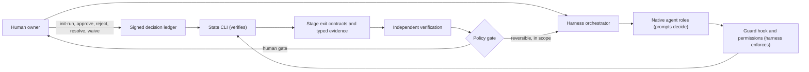

# AgenticTeam

AgenticTeam is a portable AI delivery organization for building complete platforms with
native coding-agent harnesses. Version 3 provides **50 roles**, a deterministic state CLI,
autonomous and human-in-the-loop policies, independent Fusion councils, optional BMAD-inspired
progressive context, stage exit contracts, typed evidence, a signed human decision ledger, and
harness guard hooks.

It is intentionally more than a folder of personas. The coding harness executes the agents;
AgenticTeam supplies native role definitions, skills, task/state discipline, context contracts,
and durable artifacts so the work survives parallelism, context loss, and human handoffs.

The v3 rule: **prompts decide, the CLI verifies, the harness enforces**, and the
[guarantee ledger](docs/architecture.md#guarantee-ledger) says which of the three backs each
promise.

> "Fully autonomous" means the team can continue through reversible, in-scope local work. It
> never means unapproved production deployment, public messaging, spending, credentials/payment
> operations, destructive actions, broad system changes, or legal commitments.

## What is included

- **32 core roles:** leadership, product, architecture, engineering (including data
  engineering), QA, research, documentation, and a complete marketing organization.
- **18 conditional specialists:** integration, admin/back office, SRE, performance,
  accessibility, privacy, release, analytics, FinOps, localization, compliance, context
  engineering, system mapping, Fusion moderation, customer success, trust and safety,
  fraud and risk, and AI evaluation.
- **Access classes:** every role is `read-only`, `research`, `review`, `workspace-write`, or
  `orchestrate`, compiled into each harness's native tool and permission settings. Review roles
  run tests and record evidence without editing source; orchestrators get the delegation tool.
- **13 harness targets:** Claude Code, Codex, OpenCode, Google Antigravity, Gemini CLI, Pi,
  GitHub Copilot, Cursor, Factory Droid, Kiro, Qwen Code, JetBrains Junie, and a generic portable
  format, each emitted from formats verified against vendor docs ([harnesses](docs/harnesses.md)).
- **Model profiles:** roles carry a tier (deep, standard, fast); `--model-profile` maps tiers to
  harness models and effort (`balanced` by default; `inherit`, `max-quality`, `economy`).
- **Guard hook:** on Claude Code and Codex a `PreToolUse` hook denies agent access to the owner's
  token folder, writes to run records, and deploy/publish-style commands without an approved
  task. It stops shortcuts, not hostile code ([harness security](protocols/harness-security.md)).
- **Signed decision ledger:** the human starts each run and holds an owner token outside the
  project. Approvals, rejections, resolutions, and waivers are HMAC-signed and hash-chained in
  `~/.agentic-team/ledger/`; gates read the ledger, and `audit verify` detects forgery.
- **Four autonomy profiles:** `autonomous`, `supervised`, `hitl`, and `unattended`, over one
  policy file (`config/policies.json`). Risk comes from what a task does and where
  (`--action`/`--target`), not from words in its title. Seven hard human gates hold in every
  profile; `unattended` swaps the release-stage click of a run with no task above R1 for five
  executable conditions (checks passed, HEAD verified, rollback rehearsed, no open budget question).
- **Stage exit contracts:** `advance` leaves a stage only when its required artifacts exist
  without template placeholders, acceptance ids trace to tasks and checks, and
  `VERIFICATION.md` carries a verdict from a verifier who did not build the work.
- **Typed evidence and `exec`:** completion evidence is a hashed file, a recorded command run
  with its exit code, a resolved commit, a URL, or a note. Build tasks must declare an acceptance
  check; `complete` runs it at the current HEAD and refuses while it fails.
- **Verification pinned to HEAD, spend pinned to a ceiling:** the verdict names the current
  HEAD and release refuses to exit if HEAD moved; unwatched runs start only with a token or USD
  ceiling, counted from what agents report and what the owner meters from harness transcripts.
- **Fusion mode:** independent proposals, reveal, cross-critique, synthesis, independent
  verification, and a preserved dissent record, in a one-way phase order.
- **Progressive context:** short router files, numbered stage contracts, one home per fact, and
  task-sized 2K–8K-token packs.
- **Durable supervisor (offline-verified):** `supervise` turns triggers (manual, labelled GitHub
  issues, dropped files) into runs with one bounded worker per checkout, records each attempt and
  its budget reservation before the worker starts, meters the frozen transcript exactly once,
  audits the ledger, and holds for the human instead of deciding. Paid workers need a verified
  isolation boundary; no paid pilot has run yet ([operator guide](docs/supervisor-operator-guide.md)).
- **Evals:** six deterministic team scenarios (greenfield, plan-given, rejection and recovery,
  self-approval, Fusion, brownfield fix) run against installed CLIs in the test suite and CI.
- **External-skill routing with always-on floors:** `adminwright` (admin consoles),
  `design-architect` (UI systems), and Open Code Review (`ocr`) are detected by the `preflight`
  command and routed to when installed, while `protocols/admin-surfaces.md`,
  `interface-closure.md`, and `review-discipline.md` carry the same disciplines internally
  ([integration plan, historical](docs/skills-integration-plan.md)).

## Architecture



The filesystem is durable coordination; the CLI is its single state writer. Native subagents may
work concurrently when their dependencies and owned paths do not overlap. Details:
[architecture](docs/architecture.md).

## Install

Requires Python 3.10+ that actually runs (on Windows, `py -3` or python.org Python, not the
Microsoft Store stub; the installers probe for one).

Windows (PowerShell):

```powershell
Set-ExecutionPolicy -Scope Process Bypass
.\scripts\install.ps1 -List
.\scripts\install.ps1 -Target C:\path\to\project -Harness codex -Preset full-platform
.\scripts\install.ps1 -Target C:\path\to\project -Harness claude-code -Agents ceo,delivery-lead,fullstack-engineer,qa-lead,code-reviewer
```

macOS/Linux:

```bash
./scripts/install.sh --list
./scripts/install.sh --target ~/project --harness claude-code --preset full-platform
```

Directly through the CLI, with a model profile, and to remove an installation:

```bash
python scripts/agentic_team.py install ~/project --harness claude-code --preset platform-core --model-profile economy
python scripts/agentic_team.py install ~/project --harness claude-code --preset platform-core --model-profile inherit
python scripts/agentic_team.py uninstall ~/project
```

The installer keeps project-local knowledge and runs, keeps your text outside the managed
AgenticTeam block in root instruction files, and merges its entries into harness settings
instead of overwriting them. A generated file you edited locally is never silently replaced:
reinstall stops, and `--force` backs it up first. `uninstall` keeps `knowledge/` and `runs/`
unless `--purge`. Upgrading from v2: [migration guide](docs/migration-v3.md).

## Start a build

**You start the run, in your own terminal**, because it creates the owner token that proves a
decision came from you, and that token must never reach an agent:

```powershell
py -3 .agentic-team/bin/agentic_team.py init-run --project . --name "My Platform" --autonomy supervised --entry idea --context bmad-progressive
```

```bash
python3 .agentic-team/bin/agentic_team.py init-run --project . --name "My Platform" --autonomy supervised --entry idea --context bmad-progressive
```

It prints where it wrote the token (`~/.agentic-team/owner-tokens/<run-id>.<uid>.token`). Then
ask the harness:

> Use the `agentic-build` skill. The run is started. Build this platform completely and
> activate specialists when their triggers apply: [idea or plan].

The team drives the lifecycle commands itself. When it reaches a decision it stops and shows you
the checkpoint; you approve, reject, or resolve it in your terminal with `--token-file`. The
[owner guide](docs/quickstart-non-dev.md) walks through every step.

## Entry and context modes

| Entry | Behavior |
|---|---|
| `idea` | Product definition → solution → readiness → build → verify → release → learn. |
| `plan-given` | Adopt the supplied plan, run a bounded readiness pass, then execute. |
| `execute-only` | Build the supplied authority without generating a competing plan. |

`adaptive` context suits clear, bounded work: one `BRIEF.md` with acceptance ids replaces the
early stage documents. `bmad-progressive` requires the full document for every stage. Human-
provided plans stay authoritative in both.

## Fusion mode

Ask:

> Use `fusion-council`. Have product, architecture, UX, security, and FinOps independently
> propose a product plan, challenge one another, then give me one coherent verified plan with
> disagreements preserved.

Fusion is useful for product direction, architecture selection, migrations, risk reviews, and
high-cost decisions. It is not used for routine tasks where debate would only add latency.

## Presets

| Preset | Purpose | Orchestrator | Verifier | Reviewer |
|---|---|---|---|---|
| `full-company` | All 50 roles; specialists still activate conditionally. | ceo, delivery-lead, cmo, fusion-moderator | qa-lead | code-reviewer |
| `full-platform` | Leadership, engineering, support, and every specialist. | ceo, delivery-lead, fusion-moderator | qa-lead | code-reviewer |
| `platform-core` | Compact core product delivery organization. | ceo, delivery-lead | qa-lead | code-reviewer |
| `fusion-product-council` | Multi-lens product/technical Fusion planning. | fusion-moderator | qa-lead | — |
| `regulated-platform` | Privacy, compliance, security, accessibility, and release depth. | ceo, delivery-lead | qa-lead | code-reviewer |
| `scale-readiness` | Reliability, performance, cost, privacy, security, and release audit. | delivery-lead | — | code-reviewer |
| `audit` | Independent brownfield/product/architecture/quality review. | delivery-lead | qa-lead | code-reviewer |
| `marketing-only` | Complete marketing organization. | cmo | — | — |
| `launch` | Product delivery plus go-to-market and customer success. | ceo, delivery-lead, cmo | qa-lead | code-reviewer |

`validate` checks preset coverage: build presets need an orchestrator, `qa-lead`, and
`code-reviewer`; Fusion presets `fusion-moderator` and `qa-lead`; audit presets an orchestrator;
marketing presets `cmo`. The canonical manifest is [team.json](team.json);
[team.yaml](team.yaml) is only a compatibility pointer.

## Verification

```powershell
python scripts/agentic_team.py validate
python -m unittest discover -s tests
python evals/run_scenarios.py
```

`validate` checks the manifest, the roster lint, presets, skills, and the guarantee ledger. The
test suite compiles every harness package and covers the task lifecycle, authority and forgery,
evidence and stage exits, events and budgets, the guard hook, and doc/CLI consistency. The eval
runner drives the six team scenarios against installed CLIs.

## Documentation

- [Plain-language owner guide](docs/quickstart-non-dev.md)
- [Migrating from v2](docs/migration-v3.md)
- [Architecture, runtime, and guarantee ledger](docs/architecture.md)
- [Harness-native installation](docs/harnesses.md)
- [Harness security and threat model](protocols/harness-security.md)
- [Runtime CLI reference](docs/cli.md)
- [Autonomy, Fusion, and progressive context](docs/operating-modes.md)
- [Supervisor operator guide](docs/supervisor-operator-guide.md) (implemented, offline-verified; [design](docs/supervisor-design.md), [progress](docs/supervisor-progress.md))
- [Running the team on local LLMs](docs/local-llms.md)
- [Shared protocols](protocols/)
- [Third-party inspiration and licenses](THIRD_PARTY_NOTICES.md)

No agent team can guarantee a "perfect" project. AgenticTeam raises the ceiling by making claims
traceable, reviews independent, context bounded, specialist coverage explicit, and dangerous
actions human-controlled, and by being explicit about which of those the code enforces.
